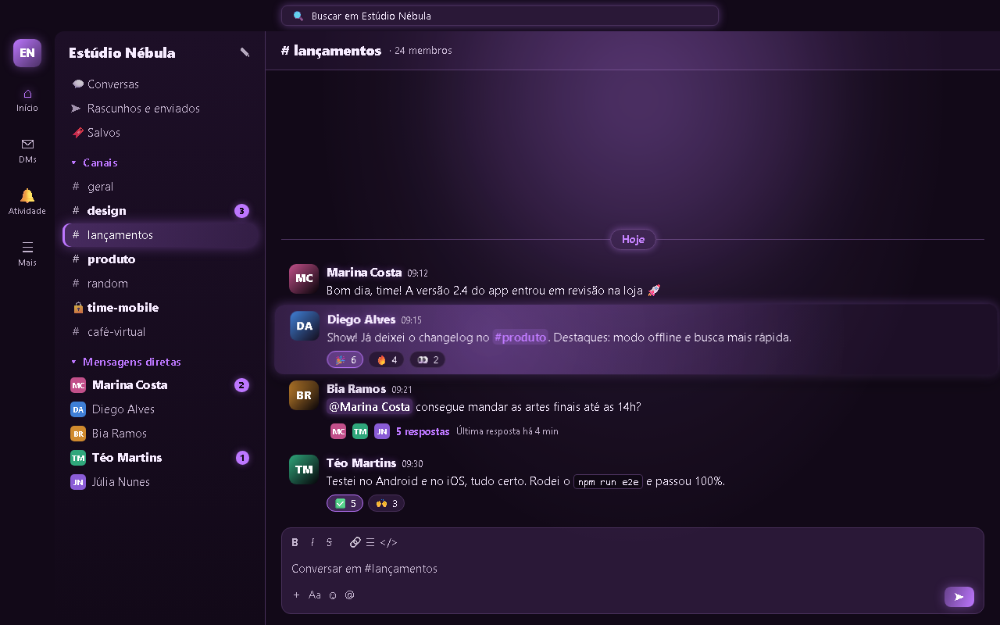
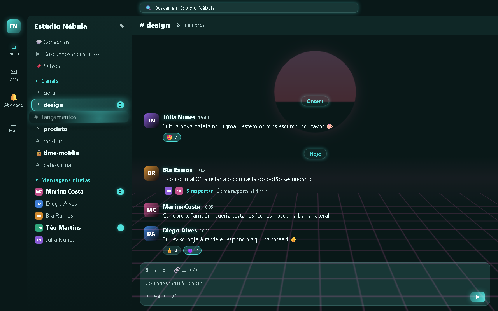
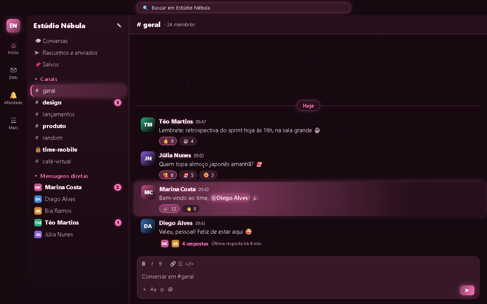
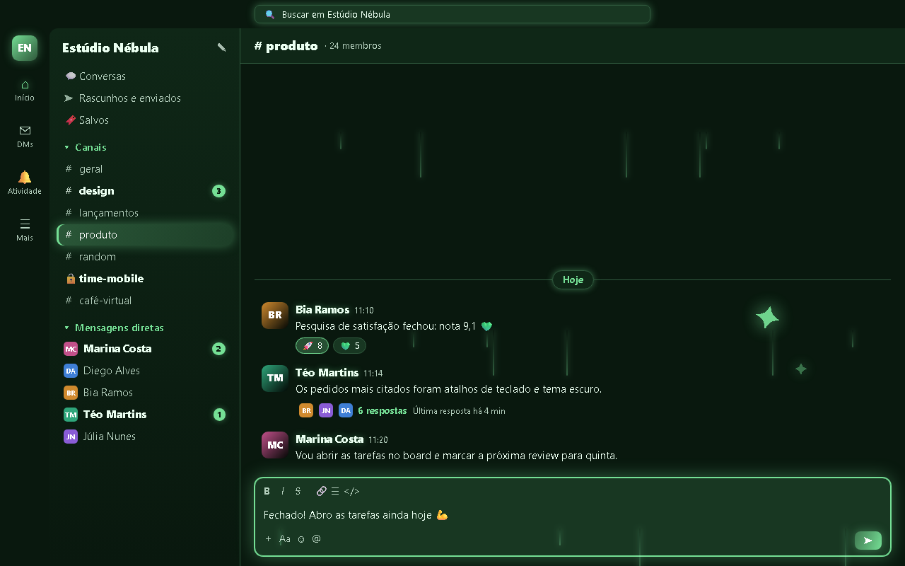
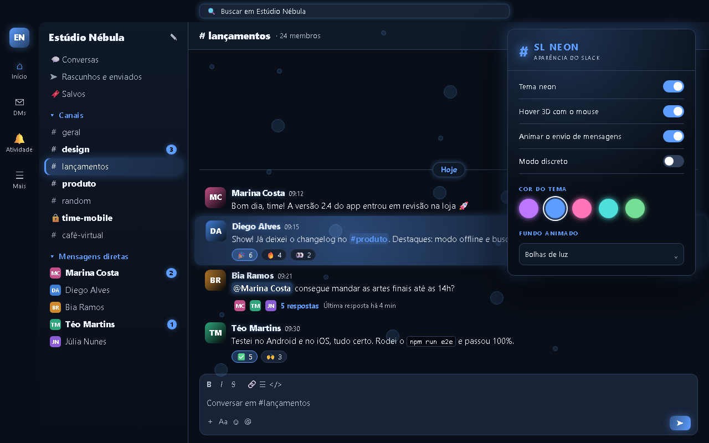

# SL Neon para Slack

**SL Neon** é uma extensão gratuita para o Google Chrome que transforma o visual do Slack no navegador num tema escuro neon, com fundos animados e efeitos 3D que acompanham o mouse.

É só aparência: a extensão muda cores, botões, menus e animações direto na página do Slack aberta no seu navegador (`app.slack.com`). Ela **não lê suas mensagens para enviar a lugar nenhum**, não tem servidor, não faz conexão de rede e não coleta dados.

> Projeto independente, sem relação com a Slack Technologies ou a Salesforce. "Slack" é marca da Slack Technologies, LLC.

Irmãos: [GM Neon para Gmail](https://github.com/lukscf/gmail-neon) e [WP Neon para WhatsApp Web](https://github.com/lukscf/whatsapp-neon-transcriber).

## Como fica

| Ciano com grade synthwave: canal da barra lateral em 3D | Rosa com fundo de estrelas |
|---|---|
|  |  |

| Verde com chuva neon: faísca ao enviar | Azul com bolhas de luz e o popup |
|---|---|
|  |  |

As imagens usam um Slack fictício (pessoas, canais e mensagens inventados), com o CSS real da extensão. Para gerar de novo: `docs/fonte/shots.html`.

## O que faz

- Tema escuro neon no Slack inteiro: barra lateral, faixa da esquerda, topo, conversa, threads, menus e janelas.
- 5 cores: roxo, azul, rosa, ciano e verde. A cor tinge a tela toda (fundo, painéis, bordas e texto secundário), e o ícone da barra do Chrome acompanha.
- 10 fundos animados: aurora, estrelas, chuva Matrix, grade synthwave, bolhas de luz, hiperespaço, chuva neon, vaga-lumes, órbitas de luz ou nenhum.
- Hover 3D: mensagens inclinam de leve com um brilho no ponto do mouse; canais, botões da faixa e reações inclinam e brilham.
- Campo de mensagem com borda neon pulsando e uma faísca que voa ao enviar.
- Modo discreto (Alt+P): borra mensagens e nomes de canais até passar o mouse.
- Corretor de contraste: superfícies claras que o Slack mantém viram escuras e texto escuro vira claro.
- Respeita "reduzir movimento" do sistema.

Funciona no Slack aberto no Chrome (`app.slack.com`). O aplicativo de desktop do Slack não roda extensões do Chrome.

## Instalar pelo código

1. Baixe este repositório (**Code → Download ZIP**) e extraia numa pasta permanente.
2. Abra `chrome://extensions`, ative **Modo do desenvolvedor** e clique em **Carregar sem compactação**.
3. Escolha a pasta extraída e recarregue a aba do Slack (F5).

## Privacidade

## Avisos de mensagens (1.2)

| Situação | Aviso |
|---|---|
| Slack aberto e em foco | Aviso **neon** no canto da página, na cor do tema, com foto, nome e prévia; clique abre a conversa |
| Slack em segundo plano | Aviso do **Windows** com o ícone do SL Neon na cor do tema e o botão **Abrir no Slack** |
| As duas opções desligadas | Aviso original do navegador |

O aviso do Windows segue o visual do sistema; extensões não conseguem pôr cores nele. No popup:
- **manter o aviso até fechar**;
- **esconder o texto das mensagens**, para compartilhar a tela (o modo discreto também esconde);
- **Testar aviso**.

Veja [PRIVACY.md](PRIVACY.md). Resumo: nenhum dado é coletado, guardado ou enviado. Só as preferências (cor, fundo, efeitos) ficam no `chrome.storage.local` do seu Chrome.

## Problemas e sugestões

Abra uma [issue](https://github.com/lukscf/slack-neon/issues).
